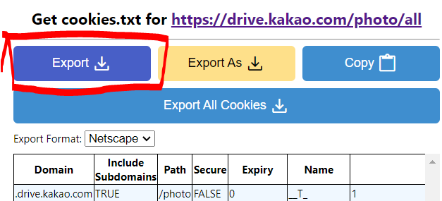

# kakao-backup

KakaoTalk TalkCloud backup & data extraction toolkit.

Two backup approaches in one project:

| Approach | Auth method | Scripts |
|----------|-------------|---------|
| **Drive API** (cookie-based) | Exported browser cookies | `backup_photos.py` |
| **TalkCloud CDP** (browser session) | Chrome DevTools Protocol | `collect_metadata.py`, `extract_content.py`, `download_media.py` |
| **macOS DB Decryption** | SQLCipher + deviceUUID + userId | `decrypt_macos_db.py` |

## Setup

```bash
# Clone and install
git clone <repo-url>
cd talkdrive-backup
python -m venv .venv && source .venv/bin/activate
pip install -e .

# Configure environment
cp .env.example .env
# Edit .env with your Neo4j password, Chrome debug port, etc.
```

## Quick Start

### 1. Photo Backup (Drive API)

Export cookies from your browser, then:

```bash
python scripts/backup_photos.py              # backup + delete from cloud
python scripts/backup_photos.py --no-delete  # backup only (safe mode)
```

Cookie export: Install a cookie export extension, visit `drive.kakao.com`,
export to `drive.kakao.com_cookies.txt` in the project root.



### 2. Metadata Collection (TalkCloud CDP)

Start Chrome with debugging enabled:

```bash
# macOS
/Applications/Google\ Chrome.app/Contents/MacOS/Google\ Chrome \
  --remote-debugging-port=18792
```

Log into `talkcloud.kakao.com`, then:

```bash
python scripts/collect_metadata.py    # 13-step metadata collection
python scripts/extract_content.py     # organize by chatroom
python scripts/download_media.py      # download media files
```

### 3. macOS DB Decryption

macOS 카카오톡의 로컬 암호화 DB에서 전체 채팅 메시지를 추출한다.

Prerequisites:
```bash
brew install sqlcipher
C_INCLUDE_PATH=$(brew --prefix sqlcipher)/include \
  LIBRARY_PATH=$(brew --prefix sqlcipher)/lib \
  pip install pysqlcipher3
```

사용법:
```bash
# 통계 확인 (자동 감지)
python scripts/decrypt_macos_db.py

# 전체 메시지 JSON 내보내기
python scripts/decrypt_macos_db.py --export data/kakaotalk_messages.json

# 특정 채팅방만 내보내기
python scripts/decrypt_macos_db.py --export data/chat.json --chat-id 163787201460229

# 커스텀 SQL 쿼리
python scripts/decrypt_macos_db.py --query "SELECT count(*) FROM NTChatMessage"

# userId를 이미 알고 있을 때 (브루트포스 생략)
python scripts/decrypt_macos_db.py --user-id 236788016
```

상세 문서: [research/decryption/macos_sqlcipher.md](research/decryption/macos_sqlcipher.md)

### 4. Neo4j Graph Sync

```bash
python scripts/sync_neo4j.py
python scripts/sync_neo4j.py --data data/dump_20250129/kakao_talkcloud_dump.json
```

## Project Structure

```
kakao_backup/          # Core package
  config.py            # Unified config (env vars via python-dotenv)
  cdp_client.py        # Chrome DevTools Protocol API client
  cookie_auth.py       # Cookie-based auth for Drive API
  neo4j_sync.py        # Neo4j graph sync logic
  utils.py             # Retry, sanitize, verify, state management

scripts/               # CLI entry points
  backup_photos.py     # Photo backup with deletion safety
  collect_metadata.py  # 13-step metadata collection
  extract_content.py   # 7-stage content extraction by chatroom
  download_media.py    # Resume-capable media downloader
  sync_neo4j.py        # Neo4j sync CLI wrapper
  decrypt_macos_db.py  # macOS KakaoTalk DB decryption & export

research/              # Non-production research
  api_exploration/     # API reverse-engineering scripts
  decryption/          # DB decryption research docs
```

## Encrypted Chat Backup

TalkCloud의 18,222+ 서버 암호화 메시지는 모바일 앱에서만 복원 가능하나,
**macOS 카카오톡 로컬 DB 복호화**를 통해 전체 메시지 추출에 성공했다 (18,620개 메시지).

`scripts/decrypt_macos_db.py`로 바로 사용 가능. 상세 문서:
[research/decryption/macos_sqlcipher.md](research/decryption/macos_sqlcipher.md)
